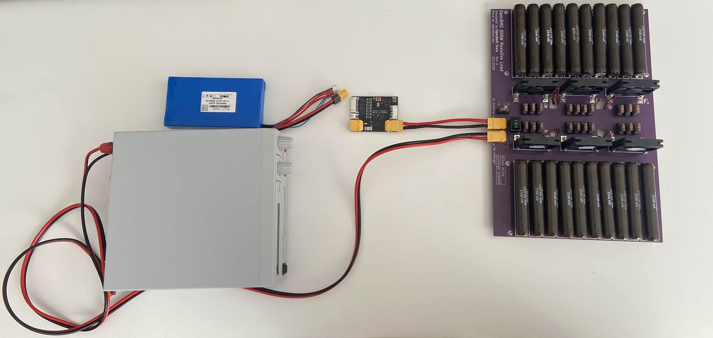

# 🚀 How to Use

A brief, end-to-end walkthrough: get the repo set up, flash the board, give it a config, run the on-board HPPC test, and use the BMS. Each step links to the doc with the full detail — this page is just the path through them in order.

## 1. First-time setup

Clone the repo and install the [Prerequisites](README.md#prerequisites) from the main README (STM32CubeIDE for VS Code extension). Open the `firmware/` folder in VS Code through that extension so `CUBE_BUNDLE_PATH` and the CMake presets resolve correctly.

The host-side scripts need Python 3. They install the modules they are missing (`pyserial`, `matplotlib`) on their first run, or install them by hand:

```
pip install pyserial matplotlib
```

Connect the board over USB-UART. The scripts find the board by pinging every serial port, so the COM port is optional everywhere below; pass it when more than one board is connected.

## 2. Build and flash the firmware

Build the `firmware` project from VS Code (STM32CubeIDE extension) — this produces `firmware/build/Release/openbms-firmware.hex`.

On a fresh board, flash the bootloader once using an STM32 SWD programmer (see the `bootloader/` project) — `flash.py` talks to the board over UART, and that only works once the bootloader is already on the chip. Then flash the firmware itself:

```
python python_scripts/flash.py [COM_PORT]
```

Without a file it takes the newest `.hex` in `firmware/build/Release`. Flashing keeps the config saved in the EEPROM.

## 3. Write the config

A new board has no config: it waits in WAIT_CONFIG with the FET off. The config — cell count, capacity, protection thresholds and times, calibration, balancing and device info — lives in a `config.json` inside a test folder, e.g. `python_scripts/simulation/7_cell_2000mAh/config.json`. Copy that folder for your own pack and edit `config.json` (keys are the `Config_Data_t` field names, see [communication-protocol.md](communication-protocol.md#config--0x30--0x6a)). Then:

```
python python_scripts/config_tool.py w <test_folder> [COM_PORT]
```

This writes every value, saves the config to the EEPROM, reboots the board and reads everything back to check it. After the reboot the board is in NORMAL_RUN. Do this again after a firmware update that changes the config layout — the board then refuses the old saved config and waits in WAIT_CONFIG.

Check the board:

```
python python_scripts/bms_cmd.py status
python python_scripts/read_all_registers.py
```

`status` shows cell voltages, current, temperatures, FET, balancing, state, HPPC status, protections, errors and SOC. `read_all_registers.py` dumps every register.

## 4. Run the HPPC test on the board

The BMS measures its own battery model with an HPPC test. This runs on real hardware — the board, the battery pack, and a charger or a load (e.g. a resistive test bench). The BMS switches the FET itself; the charger or load just has to be connected. Example setup:



Before starting:

- The current of the charger or load must be within 0.5–2 C of `cell_capacity`.
- The pack temperature must be within 15–35 °C.
- For the charge test the pack should be empty (it ends at `voltage_cell_max`), for the discharge test full (it ends at `voltage_cell_min`).
- Set `ocv_v_lo_mv` / `ocv_v_hi_mv` to the cell's real operating window.

Start the test, once with the charger connected and once with the load connected:

```
python python_scripts/hppc_run.py start
```

The script checks the board first, counts down 5 s, starts the test, then shows its progress and any failure, and logs it to `python_scripts/logs/`. Pressing `q` leaves the script without touching the test; `hppc_run.py monitor` watches it again later, `hppc_run.py plot <log>` plots the log.

The board detects the direction, then steps through 20 SOC points with a 450 s rest at each, so one direction takes several hours. The live line shows the HPPC state, stop reason and extraction warnings. At the end, the state is DONE and the tables of that direction are written to the fuel gauge registers; a discharge test also writes each cell's capacity. The test stops without writing anything on a protection trip, a current out of range for 2 s or a temperature out of range for 5 min. `hppc_run.py stop` stops it by hand.

After the test the board stays in HPPC_RUN with the FET off; `bms_cmd.py reset` takes it back to NORMAL_RUN. See [battery-model.md](battery-model.md#parameter-extraction) for how the parameters are extracted.

> **Note:** the extracted model is kept in RAM only, until storage of the model in the EEPROM is added. Read it out with `read_all_registers.py` **before** the reboot. After a reboot the fuel gauge uses the model built into the firmware (from `python_scripts/simulation/7_cell_2000mAh/fuel_gauge_registers.json`).

## 5. Use the BMS

In NORMAL_RUN the board protects the pack, estimates the SOC and balances the cells on its own:

- **FET** — `bms_cmd.py fet on` / `fet off` (and `prefet on` / `off` for the pre-charge FET). Any protection trip turns the FET off; `bms_cmd.py reset protection` clears the trip.
- **Status** — `bms_cmd.py status`, or read registers over UART or I²C, or listen to the CAN status broadcast (pack, cells, SOC, temperature, state every 100 ms). See [communication-protocol.md](communication-protocol.md).
- **SOC** — Kalman filter on the cell model, corrected at full charge and after rests; the capacity of each cell is learned over time. See [battery-model.md](battery-model.md#soc-estimation-with-an-extended-kalman-filter).
- **Faults** — the first protection trip is stored in the fault snapshot (`0x70`–`0x75`) until `bms_cmd.py clear fault`.

## 6. Test without a battery (optional)

The firmware can be tested against a simulated battery on the PC: build with `#define OPENBMS_SIMULATION` uncommented in `firmware/Core/Inc/config.h`, flash, write the config, then run the test scripts:

```
python python_scripts/config_tool.py w 7_cell_2000mAh
python python_scripts/simulation/hppc_simulate.py 7_cell_2000mAh
python python_scripts/simulation/soc_simulate.py 7_cell_2000mAh
python python_scripts/simulation/protection_simulate.py 7_cell_2000mAh
python python_scripts/simulation/balance_simulate.py 7_cell_2000mAh
```

Each prints a PASS/FAIL summary. In this build the FET pins stay off. Flash a normal build again before using the board on a real pack. See [python-script.md](python-script.md#simulation-scripts).

## See also

- [python-script.md](python-script.md) — full reference for every script: inputs, outputs, flags.
- [battery-model.md](battery-model.md) — the battery model, HPPC extraction and Kalman filter behind these numbers.
- [communication-protocol.md](communication-protocol.md) — UART, I²C and CAN protocol and the register map.
