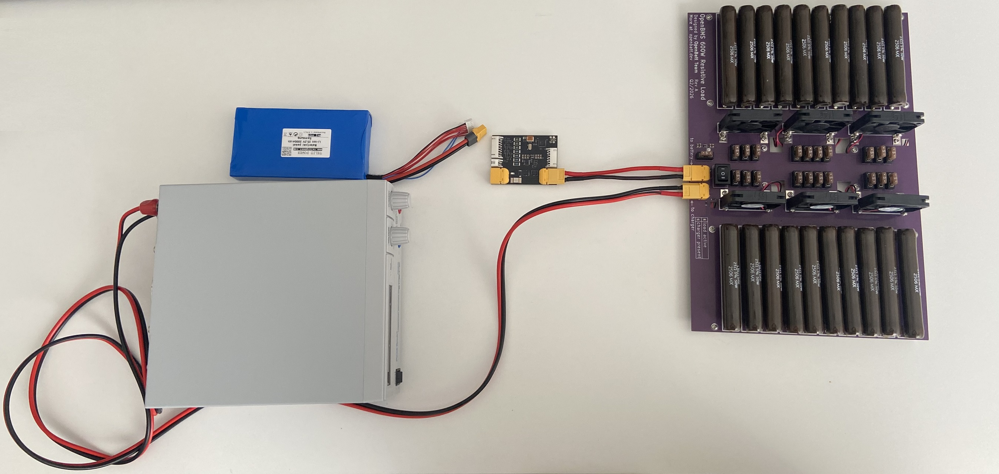

# 🚀 How to Use

A brief, end-to-end walkthrough: get the repo set up, flash the board, give it a config, run the on-board HPPC test, and use the BMS. Each step links to the doc with the full detail — this page is just the path through them in order. All steps go through the register map and commands in [communication-protocol.md](communication-protocol.md); any host that speaks the OpenBMS frames over UART (230400 baud) or I²C (`0x0B`) can do them, for example [openbms-studio](https://github.com/open-batt/openbms-studio).

## 1. First-time setup

Clone the repo and install the [Prerequisites](README.md#prerequisites) from the main README (STM32CubeIDE for VS Code extension). Open the `firmware/` folder in VS Code through that extension so `CUBE_BUNDLE_PATH` and the CMake presets resolve correctly.

Connect the board to the host over USB-UART (or I²C).

## 2. Build and flash the firmware

Build the `firmware` project from VS Code (STM32CubeIDE extension) — this produces `firmware/build/Release/openbms-firmware.hex`.

On a fresh board, flash the bootloader once using an STM32 SWD programmer (see the `bootloader/` project). After that the firmware can be flashed over the UART through the bootloader: send `CC_BOOTLOADER` (a single `B` byte), then erase, program the HEX records, verify the CRC and start the application with the bootloader's ASCII commands — see [Bootloader entry](communication-protocol.md#bootloader-entry). The firmware can also be flashed over SWD directly. Flashing keeps the config, the fuel gauge model and its state saved in the EEPROM.

## 3. Write the config

A new board has no config: it boots to NORMAL_RUN, but the protections, FET control, balancing and HPPC stay off. The config — cell count, capacity, protection thresholds and times, calibration, balancing and the cell chemistry string — is the register bank `0x30`–`0x6C` (see [communication-protocol.md](communication-protocol.md#config--0x30--0x6c)). There are no firmware defaults, so write every register, then:

1. send `CC_EEPROM_CONFIG` (`0x05`),
2. read `eeprom_status` (`0x1D`) until the save shows done,
3. send `CC_REBOOT` (`0x09`).

After the reboot `eeprom_status` bit 0 (CONFIG_LOADED) is set. Do this again after a firmware update that changes the config layout — the board then refuses the old saved config (`EEPROM_CRC_FAIL` in `error_flags`) and runs without a config.

Check the board: `ctrl_state` (`0x13`) should be 1 (NORMAL_RUN), `error_flags` (`0x15`) and `protection_trigger` (`0x12`) 0, and the cell voltages (`0x00`), current (`0x02`) and temperature (`0x03`) should be plausible.

## 4. Run the HPPC test on the board

The BMS measures its own battery model with an HPPC test. This runs on real hardware — the board, the battery pack, and a charger or a load (e.g. a resistive test bench). The BMS switches the FET itself; the charger or load just has to be connected. Example setup:

Before starting:

- The current of the charger or load must be within 0.5–2 C of `cell_capacity`.
- The pack temperature must be within 15–35 °C.
- For the charge test the pack must be empty: every cell at or below 3450 mV (`HPPC_CHG_START_MAX_MV` in `config.h`). For the discharge test it must be full: every cell at or above 4100 mV (`HPPC_DIS_START_MIN_MV`). Otherwise the board does not start the test (stop reason NOT_EMPTY / NOT_FULL). The defaults suit NMC cells; change them for another chemistry.
- No error flags may be set (`CC_CLEAR_ERRORS`), otherwise the board does not start the test.
- Set `ocv_v_lo_mv` / `ocv_v_hi_mv` to the cell's real operating window.

Start the test with `CC_HPPC_START` (`0x06`), once with the charger connected (argument 1 = charge) and once with the load connected (argument 2 = discharge). Follow it in `hppc_status` (`0x19`, state and stop reason) and `hppc_extract_status` (`0x1A`).

The board first waits with the FET off until the cells have relaxed (state SETTLE, 2 to 30 min), so a pack just charged or discharged needs no manual rest. Then it checks the direction against the current it measures (a charger connected for a discharge test stops it with stop reason WRONG_DIRECTION), then steps through 20 SOC points with a 450 s rest at each, so one direction takes several hours. At the end, the state is DONE and the tables of that direction are written to the fuel gauge registers; a discharge test also writes each cell's capacity. The test stops without writing anything on a protection trip, a current out of range for 2 s or a temperature out of range for 5 min. `CC_NORMAL_RUN` (`0x07`) stops it by hand.

The new model is then stored in the EEPROM on its own: wait for bit 15 (SAVED) in `hppc_extract_status`. After the test the board stays in HPPC_RUN with the FET off; the next test can be started right away, and `CC_REBOOT` takes the board back to NORMAL_RUN. The fuel gauge starts after the reboot once both directions are done (`learning_status` `0x96` bit 2 COMPLETE). See [battery-model.md](battery-model.md#parameter-extraction) for how the parameters are extracted.

## 5. Use the BMS

In NORMAL_RUN the board protects the pack, estimates the SOC and balances the cells on its own:

- **FET** — `CC_SET_FET` (`0x08`) 1 / 0, and `CC_SET_PRE_FET` (`0x0D`) for the pre-charge FET. Any protection trip turns the FET off; `CC_RESET_PROTECTION` (`0x0B`) clears the trip, and the FET stays off until it is switched on again.
- **Status** — read registers over UART or I²C, or listen to the CAN status broadcast (pack, cells, SOC, temperature, state, protections and errors every 100 ms). See [communication-protocol.md](communication-protocol.md).
- **SOC** — Kalman filter on the cell model, corrected at full charge and after rests; the capacity of each cell is learned over time and the state is kept in the EEPROM across power cycles. See [battery-model.md](battery-model.md#soc-estimation-with-an-extended-kalman-filter).
- **Full / empty** — `battery_status` (`0x1B`) tells the host the pack is fully charged or fully discharged; the host switches the FET off there. See [communication-protocol.md](communication-protocol.md#battery-status--battery_status-0x1b).
- **Balancing** — on its own while charging (and at rest with `balance_rest_enable`), by SOC after a rest and by voltage at the top of charge. `fet_status` (`0x06`) bits 2–8 show which cells bleed.
- **Faults** — the first protection trip is stored in the fault snapshot (`0x70`–`0x75`) until `CC_CLEAR_FAULT` (`0x12`). A measurement or hardware fault puts the board in FAULT with the outputs off; `CC_CLEAR_ERRORS` (`0x0C`) checks it again.
- **Shutdown** — `CC_SHUTDOWN` (`0x14`) saves the state and switches the board off; the WAKE_UP input starts it again. The board also shuts down on its own when it has stayed empty for 5 min with no charger. See [Shutdown](communication-protocol.md#shutdown).

## See also

- [battery-model.md](battery-model.md) — the battery model, HPPC extraction and Kalman filter behind these numbers.
- [communication-protocol.md](communication-protocol.md) — UART, I²C and CAN protocol and the register map.
